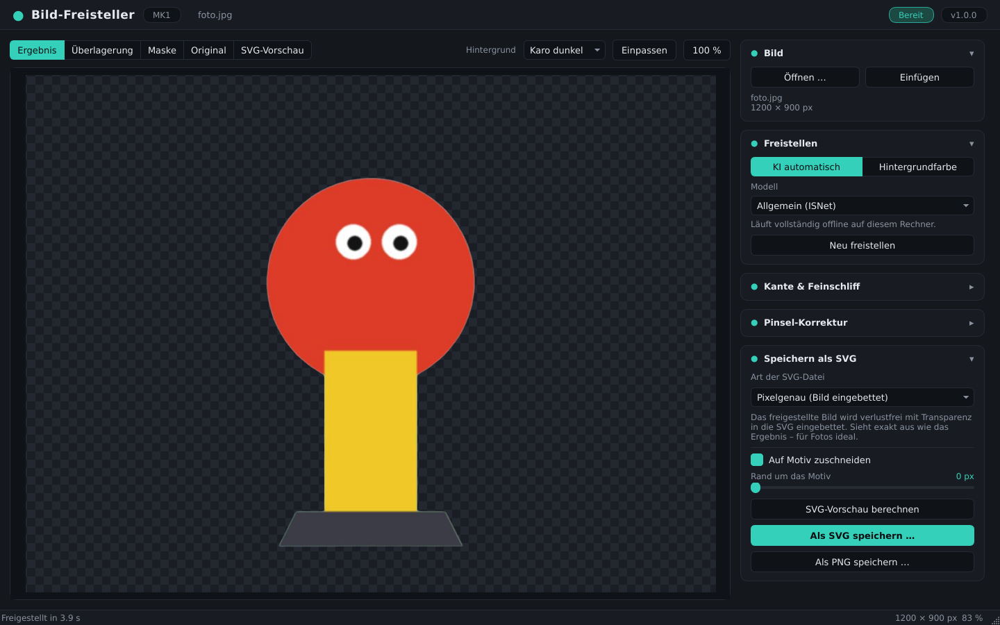

# Bild-Freisteller-MK1

Desktop-Programm für Windows: Bild per Drag & Drop hineinziehen, Hintergrund automatisch entfernen, Ergebnis als **SVG** (oder PNG) speichern. Läuft komplett offline – das KI-Modell ist in der exe enthalten.



## Funktionen

- **Bild laden** per Drag & Drop ins Fenster, über *Öffnen …* (Strg+O), aus der Zwischenablage (Strg+V) oder durch Ziehen auf die exe
  Formate: PNG, JPG, BMP, WEBP, TIFF, GIF, ICO, TGA
- **Freistellen**
  - *KI automatisch*: erkennt das Motiv selbst (ISNet-Modell, läuft lokal auf der CPU)
  - *Hintergrundfarbe*: entfernt eine Farbe – automatisch die Randfarbe oder per Pipette gewählt, mit Toleranz und weichem Übergang; wahlweise nur vom Bildrand aus oder überall (z. B. Innenflächen von Buchstaben)
- **Kante & Feinschliff**: Schwelle, weiche Kanten (Haare/Fell), Kante verschieben (Farbsäume abtragen), Kante glätten, kleine Inseln entfernen, Löcher füllen
- **Pinsel-Korrektur**: Bereiche hinzumalen (*Behalten*) oder wegradieren (*Entfernen*), mit Rückgängig/Wiederholen
- **Ansichten**: Ergebnis, Überlagerung (entfernte Bereiche rot), Maske, Original, SVG-Vorschau; Hintergrund Karo dunkel/hell, Weiß, Schwarz oder Teal
- **Speichern als SVG** in drei Arten:
  | Art | Inhalt | geeignet für |
  |---|---|---|
  | Pixelgenau | freigestelltes Bild verlustfrei mit Transparenz eingebettet | Fotos, alles was exakt aussehen soll |
  | Vektor – Farbflächen | echte, skalierbare Vektorpfade | Logos, Grafiken, Icons |
  | Vektor – Silhouette | einfarbiger Umriss des Motivs | Schneideplotter, Laser, Stempel |
- Optional auf das Motiv zuschneiden (mit Rand), zusätzlich Export als transparentes **PNG**
- Einstellungen werden in `Bild-Freisteller-MK1.ini` neben der exe gespeichert

## Bedienung

| Taste | Funktion |
|---|---|
| Strg+O / Strg+V | Bild öffnen / einfügen |
| Strg+S | Als SVG speichern |
| Strg+Umschalt+S | Als PNG speichern |
| F5 | Neu freistellen |
| 1 – 5 | Ansicht: Ergebnis, Überlagerung, Maske, Original, SVG-Vorschau |
| H / B / E | Hand / Pinsel Behalten / Pinsel Entfernen |
| I | Pipette (Hintergrundfarbe aufnehmen) |
| [ / ] oder Alt+Mausrad | Pinsel kleiner / größer |
| Strg+Z / Strg+Y | Rückgängig / Wiederholen |
| Mausrad | Zoom |
| rechte oder mittlere Maustaste ziehen | Ansicht verschieben |
| Strg+0 / Strg+1 | Einpassen / 100 % |

## Installation

Unter **Releases** die Datei `Bild-Freisteller-MK1-vX.Y.Z-windows.zip` herunterladen, entpacken und `Bild-Freisteller-MK1.exe` starten. Keine Installation nötig.

Der erste Start dauert einige Sekunden, weil die exe ihre Bestandteile (inkl. KI-Modell) entpackt.

Eigene oder weitere KI-Modelle (`.onnx`) können in den Ordner `modelle` neben der exe gelegt werden – siehe `modelle/LIESMICH.txt`.

## exe bauen

### Mit GitHub Actions

Der Workflow `.github/workflows/build-exe.yml` läuft bei jedem Push:

1. lädt das KI-Modell (mit Prüfsumme, zwischengespeichert),
2. führt den Selbsttest mit dem Quellcode aus,
3. baut mit PyInstaller eine einzelne `Bild-Freisteller-MK1.exe`,
4. führt den Selbsttest mit der fertigen exe aus,
5. packt das ZIP und lädt es als Artefakt hoch,
6. erstellt einen **Release** `vX.Y.Z`, wenn es zu der Version in `freisteller/version.py` noch keinen gibt.

Für einen neuen Release also `APP_VERSION` in `freisteller/version.py` erhöhen und pushen.

### Lokal unter Windows

Python 3.10 – 3.12 installieren, dann `build_lokal.bat` ausführen. Ergebnis: `dist\Bild-Freisteller-MK1.exe`.

### Aus dem Quellcode starten

```
pip install -r requirements.txt
python build/modell_laden.py
python app.py
```

Selbsttest ohne Fenster: `python app.py --selftest` (bzw. `Bild-Freisteller-MK1.exe --selftest`, Ergebnis in `selbsttest.log`).

## Aufbau

```
app.py                         Start, Selbsttest
freisteller/
  hauptfenster.py              Oberfläche und Ablauf
  ansicht.py                   Bildansicht (Zoom, Pinsel, Pipette, Drag & Drop)
  bausteine.py                 Karten, Schieberegler, Segment-Auswahl
  theme.py                     Farben und Stylesheet im Dashboard-Design
  segmentierung.py             KI-Freistellung (ONNX) und Farb-Freistellung
  maske.py                     Kanten-Nachbearbeitung, Pinsel-Ebene, Zuschnitt
  svg_export.py                SVG pixelgenau / Vektor (vtracer)
  pfade.py, version.py
assets/                        Icon, Pfeilgrafiken
modelle/                       KI-Modell (wird beim Build geladen)
build/                         PyInstaller-Spezifikation, Hilfsskripte
.github/workflows/             GitHub-Actions-Workflow
```

## Verwendete Bibliotheken

PySide6 (Qt), ONNX Runtime, NumPy, SciPy, Pillow, vtracer. KI-Modell *isnet-general-use* (DIS / IS-Net, Apache-2.0) aus dem Projekt rembg.
